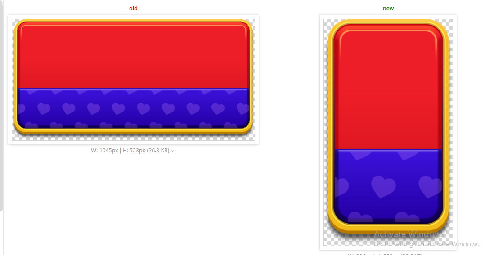

# slicing-ui-sprites

A [Claude Code](https://claude.com/claude-code) skill that shrinks Unity UI PNGs (cards, panels,
frames, headers, buttons, backgrounds) without changing how they look.

It removes only the pixels a uGUI `Image` can regenerate exactly:

- **Sliced (9-slice):** lines identical to their neighbours are dropped and stretched back.
- **Tiled:** whole periods of a repeating motif (hearts, stars, diamonds) are dropped and repeated.

The sprite keeps its GUID and its atlas, so no prefab reference changes. Every result is measured
(PSNR, tile seams) instead of eyeballed.

## Demo



Left: the original PNG. Right: the sliced and tiled PNG, drawn by a uGUI `Image` at the same on-screen look.

## Install

Copy this folder into your Unity project:

```
<your-project>/.claude/skills/slicing-ui-sprites/
```

or for all projects: `~/.claude/skills/slicing-ui-sprites/`.

```
git clone <this-repo-url> .claude/skills/slicing-ui-sprites
pip install pillow numpy
```

## Use

Ask Claude Code to shrink or optimize a UI PNG, e.g. "shrink Assets/UI/Shop/card_bg.png without
changing how it looks". The skill triggers on requests about 9-slice, Sliced/Tiled Image, sprite
borders or compressing UI art, and walks through: back up, find every user of the sprite, analyze,
slice, update the `.meta` border and Image type, verify, report.

## Scripts

All in `scripts/`, Python 3 with Pillow and NumPy:

| Script | Purpose |
|---|---|
| `find_sprite_users.py` | Lists every Image, prefab, variant override and `.cs` that uses the sprite |
| `analyze_sprite.py` | Per axis: Sliced, Tiled or keep, plus the slice command and `spriteBorder` |
| `slice_sprite.py` | Writes the shrunk PNG |
| `verify_slice.py` | Renders like uGUI and compares with the original look |

## Limits

Written for uGUI `Image` (not UI Toolkit). Always check the saving in the SpriteAtlas Pack Preview:
it only reaches the build if the atlas page gets smaller.

## License

MIT
